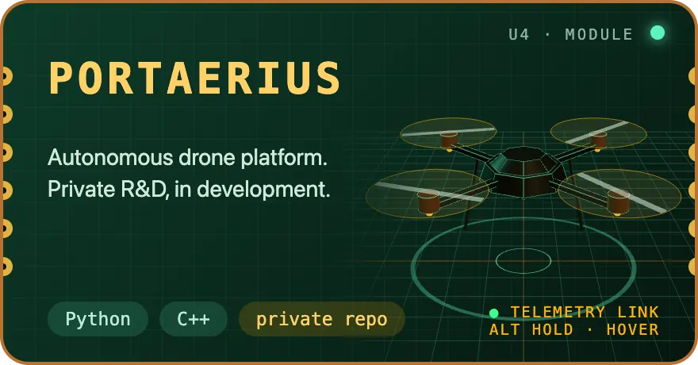
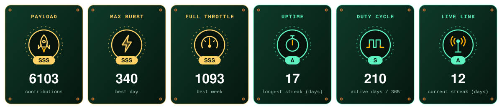
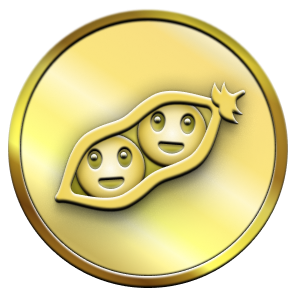

  
  
  
  

  

## 🛰️ About · À propos · Sobre mí

<b>🇬🇧 English</b>

 

I'm from Paris, France, and co-founder of **Lanjo Technologies**, a company based in Santiago, Dominican Republic, that I work with remotely. I build products end to end: database, backend, web, mobile and payments. Right now most of my time goes to **Mi SaludRD**, a platform connecting Dominican patients and doctors.

<b>🇫🇷 Français</b>

 

Je viens de Paris, en France, et je suis co-fondateur de **Lanjo Technologies**, une entreprise basée à Santiago, en République dominicaine, avec laquelle je travaille à distance. Je construis des produits de bout en bout : base de données, backend, web, mobile et paiements. En ce moment, presque tout mon temps va à **Mi SaludRD**, une plateforme qui relie patients et médecins dominicains.

<b>🇩🇴 Español</b>

 

Soy de París, Francia, y co-fundador de **Lanjo Technologies**, una empresa con sede en Santiago, República Dominicana, con la que trabajo a distancia. Construyo productos de principio a fin: base de datos, backend, web, móvil y pagos. Ahora mismo, casi todo mi tiempo va a **Mi SaludRD**, una plataforma que conecta pacientes y médicos dominicanos.

## 🔌 Projects · Projets · Proyectos

  
  

  

## 🧰 Stack

  <b>Languages · Langages · Lenguajes</b> 
  <picture>
    <source media="(prefers-color-scheme: dark)" srcset="https://skillicons.dev/icons?i=ts%2Cjs%2Cdart%2Cpy%2Cc%2Ccpp%2Cjava%2Cphp%2Cbash%2Chtml%2Ccss&perline=12&theme=dark" />
    
  </picture>

  <b>Frameworks</b> 
  <picture>
    <source media="(prefers-color-scheme: dark)" srcset="https://skillicons.dev/icons?i=nextjs%2Creact%2Ctailwind%2Cflutter%2Cnodejs%2Cgodot&perline=12&theme=dark" />
    
  </picture>

  <b>Data · Infra · Tools</b> 
  <picture>
    <source media="(prefers-color-scheme: dark)" srcset="https://skillicons.dev/icons?i=supabase%2Cpostgres%2Cvercel%2Ccmake%2Cgit%2Cgithubactions%2Cfigma%2Cvscode&perline=12&theme=dark" />
    
  </picture>

  
  

## 📡 Activity · Activité · Actividad

  

  <picture>
    <source media="(prefers-color-scheme: dark)" srcset="https://raw.githubusercontent.com/Crrenj/Crrenj/output/snake-dark.svg" />
    
  </picture>

## 🎖️ Trophies &amp; badges · Trophées · Trofeos

  

  
  
  
  
   
  <b>Pair Extraordinaire ×4</b> · <b>Pull Shark ×3</b> · <b>Quickdraw</b> · <b>YOLO</b>

