  

  
  
  
  

  

## 🃏 About · À propos · Sobre mí

<b>🇬🇧 English</b>

 

Co-founder of **Lanjo Technologies**, based in Santiago, Dominican Republic. I build products end to end: database, backend, web, mobile and payments. Right now most of my time goes to **Mi SaludRD**, a platform connecting Dominican patients and doctors.

<b>🇫🇷 Français</b>

 

Co-fondateur de **Lanjo Technologies**, à Santiago, en République dominicaine. Je construis des produits de bout en bout : base de données, backend, web, mobile et paiements. En ce moment, presque tout mon temps va à **Mi SaludRD**, une plateforme qui relie patients et médecins dominicains.

<b>🇩🇴 Español</b>

 

Co-fundador de **Lanjo Technologies**, en Santiago, República Dominicana. Construyo productos de principio a fin: base de datos, backend, web, móvil y pagos. Ahora mismo, casi todo mi tiempo va a **Mi SaludRD**, una plataforma que conecta pacientes y médicos dominicanos.

## ♠️ Projects · Projets · Proyectos

  
  

## ♣️ Stack

  <picture>
    <source media="(prefers-color-scheme: dark)" srcset="https://skillicons.dev/icons?i=ts,nextjs,react,tailwind,flutter,dart,supabase,postgres,vercel,git,figma,vscode&perline=12&theme=dark" />
    
  </picture>
    
  

## ♦️ Activity · Activité · Actividad

  

  <picture>
    <source media="(prefers-color-scheme: dark)" srcset="https://streak-stats.demolab.com?user=Crrenj&hide_border=true&background=00000000&ring=9D4EDD&fire=39FF14&currStreakLabel=C77DFF&currStreakNum=E6EDF3&sideNums=E6EDF3&sideLabels=C9D1D9&dates=8B949E&stroke=3C096C" />
    
  </picture>

  <picture>
    <source media="(prefers-color-scheme: dark)" srcset="https://raw.githubusercontent.com/Crrenj/Crrenj/output/snake-dark.svg" />
    
  </picture>

## 😈 Why so serious?

  

